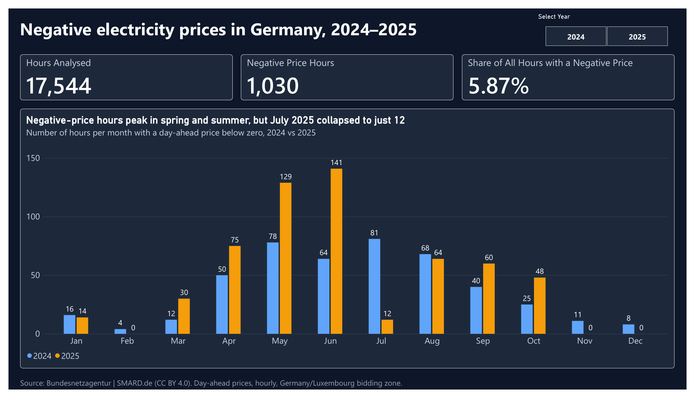
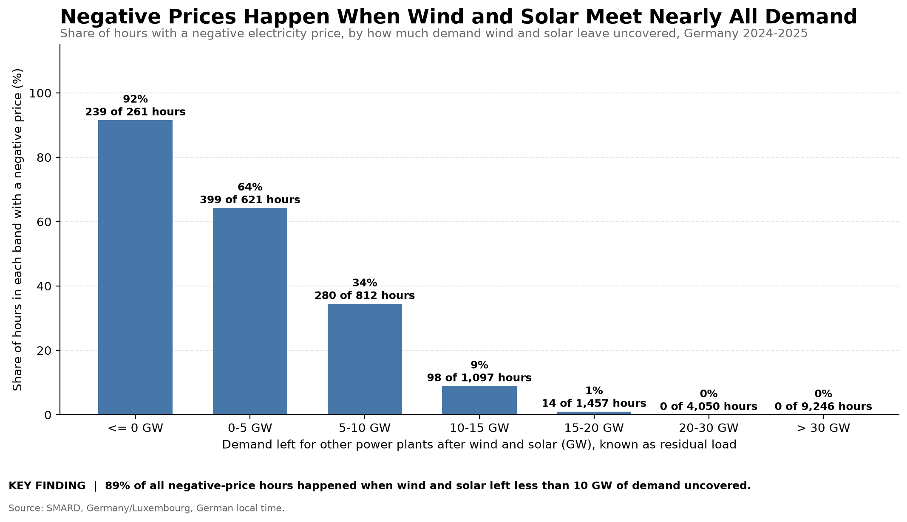
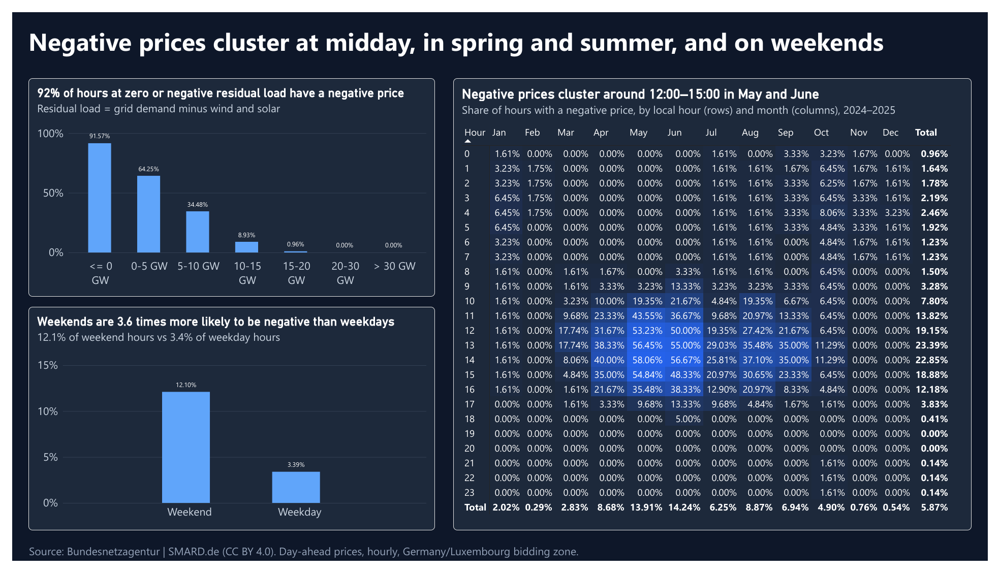
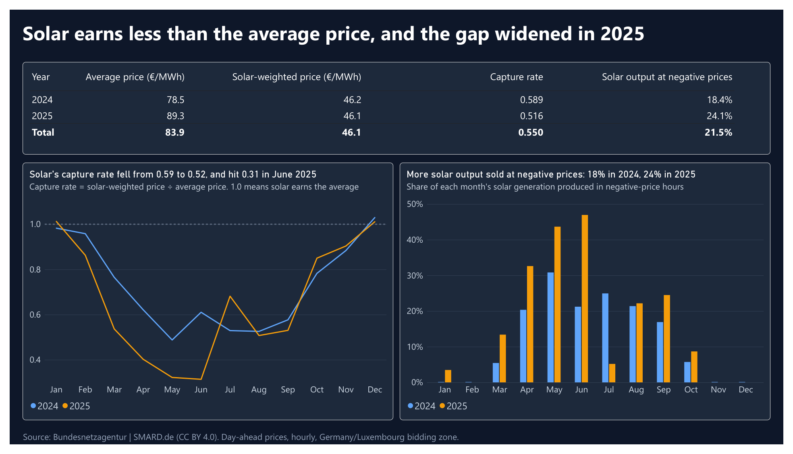

# GridSignal

**German Electricity Market Analytics · Python · pandas · matplotlib · PostgreSQL · SQL · Power BI · pytest**

Negative day-ahead electricity prices in Germany appear when wind and solar cover almost all of demand. This project turns hourly SMARD data for 2024–2025 into validated datasets, controlled comparisons, SQL queries, charts and a three-page Power BI dashboard that show when negative prices happen and what separates those hours from the rest.

**Summary.** Of 17,544 hourly day-ahead prices in 2024–2025, 1,030 (5.87%) were negative.

- **Low residual load:** when wind and solar covered all of demand, 92% of hours (239 of 261) had a negative price. With residual load above 20 GW, none did.
- **Midday and weekends:** 84% of negative-price hours fell between 10:00 and 17:00, and weekend hours were 3.6 times as likely to be negative as weekday hours (12.1% vs 3.4%).
- **Solar earns less than the average price:** its capture rate fell from 0.59 in 2024 to 0.52 in 2025, and to 0.31 in June 2025.
- **2025 was uneven:** negative-price hours rose from 457 to 573, but July 2025 dropped to 12 hours from 81 in July 2024, and that drop is only partly explained.



The project is descriptive analytics: there is no machine-learning component yet, and forecasting is an idea for later.

## In plain terms

- **Negative price:** producers pay to deliver electricity instead of being paid. It happens when more power is on offer than buyers want at a normal price, and some plants find it cheaper to keep running than to shut down.
- **Residual load:** demand minus wind and solar, the amount other power plants (gas, coal, hydro) still have to supply. When it is near zero, wind and solar cover almost everything.

## Key Findings

These are descriptive results from two years of hourly data. They show associations, not causes.

### 1. Negative prices appear when residual load is low



- When wind and solar covered all of demand (residual load of 0 GW or below), 239 of 261 hours (92%) had a negative price.
- Across the 13,296 hours with residual load above 20 GW, none did.
- 89% of all negative-price hours (918 of 1,030) happened when residual load was below 10 GW.
- Residual load has a correlation of 0.83 with price (Spearman 0.87), far stronger than demand alone (0.31).

### 2. Solar alone is a weak explanation

Average solar output is 4.55× higher in negative-price hours than in other hours (2025), but most of that gap comes from *when* negative prices happen: at midday, in the sunny months. Comparing like with like shrinks it step by step.

| 2025 comparison | Negative-price hours | Other hours | Ratio |
|---|---|---|---|
| All hours | 573 hours, 31.3 GW | 8,187 hours, 6.9 GW | 4.55× |
| Midday only (11:00–14:59) | 342 hours, 36.4 GW | 1,118 hours, 21.8 GW | 1.67× |
| Midday, April–September | 302 hours, 37.8 GW | 430 hours, 32.1 GW | 1.18× |

In 2024 the same steps give 4.11×, 1.72× and 1.16×. Values are average solar output per hour, in GW.

### 3. Negative prices cluster around midday


- 84% of negative-price hours fell between 10:00 and 17:00 German local time.
- The peak hour was 14:00 in 2024 (20.49% of those hours) and 13:00 in 2025 (27.12%).

### 4. Negative prices became more frequent in 2025, mostly in spring


- Negative-price hours rose from 457 in 2024 to 573 in 2025 (+116, or +25.4%).
- April to June added 153 hours, partly offset by July, which fell from 81 hours to 12.
- February, November and December 2025 had no negative-price hours.

### 5. The July 2025 drop is only partly explained

Low residual load alone stopped producing negative prices in July 2025. In hours with residual load below 10 GW (April–October), the share with a negative price was:

| Month | 2024 | 2025 | Neighbours' median price, 2024 → 2025 (€/MWh) |
|---|---:|---:|---|
| May | 76.8% | 73.0% | 3.0 → 8.9 |
| June | 76.5% | 70.8% | 0.6 → 4.9 |
| July | 78.0% | 19.7% | −0.1 → 17.0 |
| August | 77.6% | 44.7% | 3.3 → 7.8 |
| September | 52.5% | 53.1% | 5.0 → 22.7 |
| October | 94.7% | 33.8% | 0.5 → 29.9 |

- Of the 69-hour fall in July, 52 hours were low-residual-load hours that no longer had a negative price, and the number of low-residual-load hours also fell (82 → 61).
- In those hours, the average price in neighbouring zones was much higher in July 2025 than in July 2024. That fits the idea that negative prices need a surplus across the coupled market, not only in Germany.
- The pattern is not consistent: September 2025 had much higher neighbour prices but the same negative share as 2024, and May and June 2025 do not fit either. Without cross-border flow data this is a hint, not an explanation.
- October 2025 is also affected by the switch to 15-minute products, and October 2024 has only 19 low-residual hours.

### 6. Solar earned about half the average price in 2025

The capture rate is the average price solar output earned, weighted by how much it produced, divided by the simple average price of all hours. Below 1, solar produces when prices are lower than average.

| Period | Capture rate 2024 | Capture rate 2025 | Solar output in negative-price hours, 2025 |
|---|---:|---:|---:|
| April | 0.62 | 0.40 | 32.6% |
| May | 0.49 | 0.32 | 43.7% |
| June | 0.61 | 0.31 | 46.9% |
| July | 0.53 | 0.68 | 5.2% |
| Whole year | 0.59 | 0.52 | 24.1% |

- Solar's own weighted price was almost unchanged (46.2 €/MWh in 2024, 46.1 in 2025); the average price of all hours rose from 78.5 to 89.3, partly because of high winter prices.
- The market value of solar output sold in negative-price hours was −178 million € in 2024 and −244 million € in 2025; April to June 2025 account for about 87% of the 2025 figure.
- This is the value of all solar output at day-ahead prices, not what plant owners were paid: many plants have fixed feed-in tariffs.

### 7. Most negative prices are mild


- 70.0% of negative-price hours in 2024 and 76.4% in 2025 were between −10 and 0 €/MWh.
- Hours below −100 €/MWh rose from 5 to 13, but remain rare. The lowest price was −250.32 €/MWh (2025).

### 8. Negative prices are about 3.6 times as common on weekends

Found with SQL queries on the PostgreSQL layer (see [SQL layer](#sql-layer)).

| Hours compared | Weekend | Weekday |
|---|---:|---:|
| All hours | 12.1% negative (604 of 4,992) | 3.4% negative (426 of 12,552) |
| Midday (11:00–14:59), April–September | 67.5% negative (281 of 416) | 22.8% negative (239 of 1,048) |

- Weekends are 28.5% of all hours but contain 58.6% of the negative-price hours.
- All ten longest unbroken runs of negative prices (10 to 20 hours) started on a weekend or public holiday. The longest ran 20 hours, from the evening of 4 October to the afternoon of 5 October 2025, at an average of −2.3 €/MWh. Long runs tend to be mild; the deepest ones are short.
- Lower weekend demand is a likely reason, but it is not tested here, and public holidays are not analysed beyond these examples.

## What this means for a solar plant owner

Written for an owner who sells at market prices; owners with fixed feed-in tariffs are affected differently.

1. **Forecast revenue month by month.** The capture rate was 0.31–0.40 in April–June 2025 against 0.52 for the year, so a yearly average overstates spring revenue.
2. **Watch residual load as the warning signal.** Below 5 GW, 638 of 882 hours (72%) had a negative price; above 20 GW, none did.
3. **Treat negative-price hours as a contract question.** 24% of 2025 solar output, and 47% in June, was produced in negative-price hours, so curtailment terms and price-linked contracts matter.
4. **Do not plan on July 2025 repeating.** The capture rate was 0.68 that month, but the cause is only partly understood.
5. **Plan weekends separately.** In April–September middays, 67.5% of weekend hours had a negative price against 22.8% of weekday hours.

These are conclusions from descriptive data, not forecasts; storage and the midday-to-evening price gap are not yet analysed.

See [detailed findings](docs/findings.md) for tables, method notes and limitations.

## Power BI dashboard

A three-page interactive report built on the PostgreSQL data (17,544 hourly rows). Each chart title states its finding, and every number matches the Python and SQL results.

| Page | What it shows |
|---|---|
| 1. Overview | 17,544 hours analysed, 1,030 negative-price hours (5.87%), and negative-price hours per month for 2024 vs 2025, with a year slicer. |
| 2. When it happens | Share of negative-price hours by residual-load band, weekend vs weekday, and an hour-by-month heatmap (German local time). |
| 3. Value of solar | Capture rate and share of solar output sold at negative prices, by year and by month. |





- **Open it:** `powerbi/GridSignal.pbix` needs the free [Power BI Desktop](https://powerbi.microsoft.com/desktop/). A read-only copy for anyone without it is in `powerbi/GridSignal_dashboard.pdf`.
- **Data:** the report uses Import mode, so the data is stored inside the file and opens without a database. Refreshing it needs the local PostgreSQL database from the [SQL layer](#sql-layer).
- **Measures** (written in DAX): Total Hours, Negative Hours, Negative Share, Average Price, Solar Weighted Price, Capture Rate and Solar Share at Negative Prices.
- Page 1 (overview) is the image at the top of this README.

## Limitations

- Two years of data; the results describe associations, not causes.
- Residual load subtracts only wind and solar, not hydro, biomass or imports.
- Time of day and season are controlled in the solar comparison. Demand, wind, power-plant flexibility, cross-border flows and subsidy rules are not.
- The July 2025 analysis uses neighbouring-zone prices from SMARD, not electricity flows, so it cannot show why prices differed.
- The capture rate and the euro values use day-ahead prices for all solar output. They are not actual plant revenue, because feed-in tariffs, direct-marketing contracts and curtailment rules are not modelled.
- The weekend comparison uses Saturday and Sunday only; public holidays are not analysed, and the reason for the weekend effect is not tested.
- Negative means strictly below €0/MWh. Counting zero-price hours as well would give 519 (2024) and 655 (2025) hours.
- From 1 October 2025 the market uses 15-minute products; hourly values after that date average four quarter-hours.

The full list is in [docs/findings.md](docs/findings.md).

## Data and Method

**Source:** [SMARD](https://www.smard.de/en), Germany/Luxembourg bidding zone, hourly data for 2024–2025: day-ahead prices (including the average price of neighbouring zones), actual offshore wind, onshore wind and solar generation, and actual grid consumption. The selected generation measures are not total supply.

1. **Clean** timestamps and numeric values for each source file.
2. **Validate** required columns, duplicate timestamps and interval continuity.
3. **Combine** prices, generation and consumption on UTC timestamps (17,544 matched hourly rows: 8,784 in 2024 and 8,760 in 2025).
4. **Analyze** with grouped, controlled comparisons and fixed residual-load bands.
5. **Visualize** each finding with one chart whose numbers are computed from the data.
6. **Store and query** the combined hourly data in PostgreSQL, where SQL queries reproduce key results and answer further questions.
7. **Present** the results in a three-page Power BI dashboard connected to the PostgreSQL data.

Calendar analysis uses `Europe/Berlin` local time. All scripts read data through one shared loader, and `run_pipeline.py` runs the whole workflow in order.

## Repository Structure

```text
GridSignal/
├── data/
│   ├── raw/                  # Local source data; not tracked
│   └── processed/            # Generated datasets; not tracked
├── docs/
│   ├── findings.md
│   ├── negative_price_frequency_2024_2025.png
│   ├── negative_price_severity_2024_2025.png
│   ├── negative_price_share_by_residual_load_2024_2025.png
│   ├── hour_of_day_analysis_2024_2025.png
│   ├── negative_price_comparison_2024_2025.csv
│   ├── price_by_residual_load_band_2024_2025.csv
│   ├── price_correlations_2024_2025.csv
│   ├── solar_comparison_controls_2024_2025.csv
│   ├── hourly_negative_price_frequency_2024_2025.csv
│   ├── hourly_solar_by_price_category_2024_2025.csv
│   ├── low_residual_hours_by_month_2024_2025.csv
│   ├── solar_capture_rate_2024_2025.csv
│   ├── solar_capture_rate_by_month_2024_2025.csv
│   └── images/               # Power BI dashboard page images
│       ├── dashboard_page1.png
│       ├── dashboard_page2.png
│       └── dashboard_page3.png
├── powerbi/
│   ├── GridSignal.pbix       # Power BI report (open with Power BI Desktop)
│   └── GridSignal_dashboard.pdf
├── src/
│   └── gridsignal/
│       ├── __init__.py
│       ├── config.py
│       ├── data_loader.py
│       ├── data_validation.py
│       ├── clean_data.py
│       ├── clean_generation.py
│       ├── combine_data.py
│       ├── prepare_consumption_data.py
│       ├── analyze_solar_controls.py
│       ├── analyze_residual_load.py
│       ├── analyze_low_residual_months.py
│       ├── analyze_capture_rate.py
│       ├── analyze_negative_price_hours.py
│       ├── analyze_hour_of_day.py
│       ├── plot_negative_price_frequency.py
│       ├── plot_negative_price_severity.py
│       ├── plot_residual_load_bands.py
│       ├── plot_hour_of_day_analysis.py
│       ├── load_to_postgres.py
│       ├── inspect_dst_consumption_alignment.py
│       ├── inspect_raw_dst_rows.py
│       └── run_pipeline.py
├── sql/
│   ├── 01_schema.sql
│   ├── 02_residual_load_bands.sql
│   ├── 03_solar_capture_rate.sql
│   ├── 04_longest_negative_runs.sql
│   └── 05_weekend_effect.sql
├── tests/
├── .gitignore
├── LICENSE
├── pyproject.toml
└── README.md
```

Raw and processed datasets and local notes are excluded from version control.

## Run Locally

Instructions describe the Windows PowerShell workflow.

### Requirements

- Python 3.14 or later, as specified in the current project configuration
- pip
- Git

### 1. Clone

```powershell
git clone https://github.com/aliakbarse/GridSignal.git
cd GridSignal
```

### 2. Create and activate a virtual environment

```powershell
python -m venv .venv
.\.venv\Scripts\Activate.ps1
```

If PowerShell prevents activation, consult the Python documentation for your environment's execution-policy settings.

### 3. Install the project and development dependencies

```powershell
python -m pip install -e ".[dev]"
```

### 4. Download source data

Download the hourly day-ahead prices, actual generation and actual consumption CSV files from [SMARD](https://www.smard.de/en) and place them in `data/raw/` with these names:

```text
data/raw/
├── Day-ahead_prices_202312312100_202512312100_Hour.csv
├── Actual_generation_202312312100_202512312100_Hour.csv
└── Actual_consumption_202312312100_202512312100_Hour.csv
```

These are local inputs and are not tracked in Git. Check the applicable source terms before redistributing downloaded data.

### 5. Run the full pipeline

From the repository root:

```powershell
python -m gridsignal.run_pipeline
```

This cleans and combines the data, runs every analysis and regenerates every chart. Processed datasets are written to `data/processed/` and analysis outputs and charts to `docs/`. Each stage can also be run on its own, for example `python -m gridsignal.analyze_residual_load`.

### 6. Run tests

```powershell
python -m pytest -v
```

The tests cover key data-pipeline rules, including negative-price classification, timestamp validation and matching price and generation records. Passing tests verify the tested rules; they do not validate every analytical conclusion.

### 7. Optional timestamp and DST diagnostics

```powershell
python -m gridsignal.inspect_dst_consumption_alignment
python -m gridsignal.inspect_raw_dst_rows
```

These are diagnostic tools, not required stages of a normal run.

## SQL layer

The Python workflow does not need a database. The SQL layer is a second route to the same data: it loads the combined hourly dataset into PostgreSQL, reproduces key results with SQL (the numbers match the Python outputs) and answers further questions. It needs PostgreSQL 12 or later (developed on 18) and a database named `gridsignal`.

| File | What it does |
|---|---|
| `sql/01_schema.sql` | Creates the table `market_hours` (raw measurements, UTC timestamp as primary key) and the view `market_hours_local` (German local time, year, month, hour). |
| `sql/02_residual_load_bands.sql` | Share of negative-price hours by residual-load band; matches Finding 1. |
| `sql/03_solar_capture_rate.sql` | Solar capture rate and value at negative prices by year; matches Finding 6. |
| `sql/04_longest_negative_runs.sql` | Longest unbroken runs of negative-price hours, using the gaps-and-islands technique. |
| `sql/05_weekend_effect.sql` | Negative-price rate on weekends and weekdays, for all hours and for April–September middays. |

```powershell
$env:PGPASSWORD = "your-password"   # set in this session only; never commit it
psql -U postgres -c "CREATE DATABASE gridsignal;"
psql -U postgres -d gridsignal -f sql/01_schema.sql
python -m gridsignal.load_to_postgres
psql -U postgres -d gridsignal -f sql/02_residual_load_bands.sql
```

The loader reads the connection settings from the standard PostgreSQL environment variables (`PGHOST`, `PGUSER`, `PGPASSWORD`, `PGDATABASE`) and replaces the table contents on every run. It expects 17,544 rows and 1,030 negative-price hours.

## Next Steps

Planned, not yet implemented: holiday and night-time analysis, an analysis of the midday-to-evening price gap for storage, and automated checks on every commit.

## Data licence and credit

The market data comes from SMARD. Data downloaded from its market-data section is published under [CC BY 4.0](https://creativecommons.org/licenses/by/4.0/), with the credit **"Bundesnetzagentur | SMARD.de"**. The charts, tables, SQL results and dashboard in this repository are my own calculations on that data (aggregation, controlled comparisons and derived measures such as residual load and capture rate), not original SMARD figures.

SMARD states that the Bundesnetzagentur is reviewing the legal licensing of wholesale prices, which include the day-ahead prices used here. Check the current terms on [smard.de](https://smard.de/en/datennutzung) before reusing or redistributing the data. The raw and processed data files are not included in this repository.

## Code licence

The project code is released under the [MIT License](LICENSE). The SMARD data it analyses is not covered by this licence; see "Data licence and credit" above.
