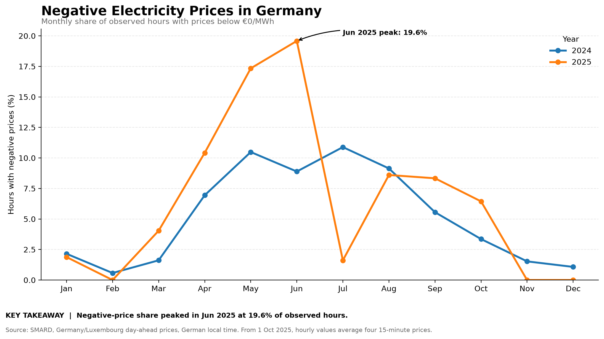
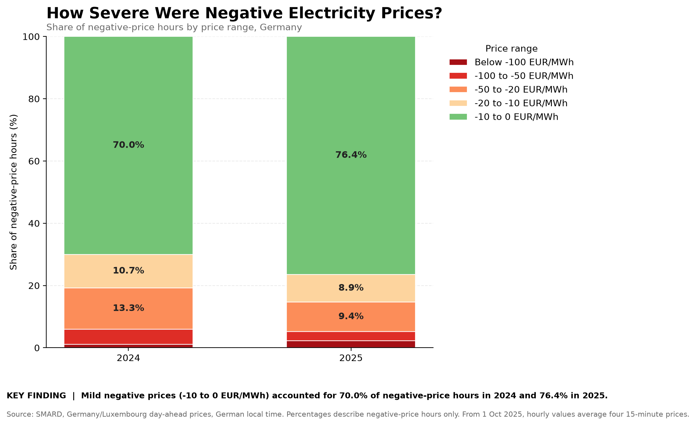
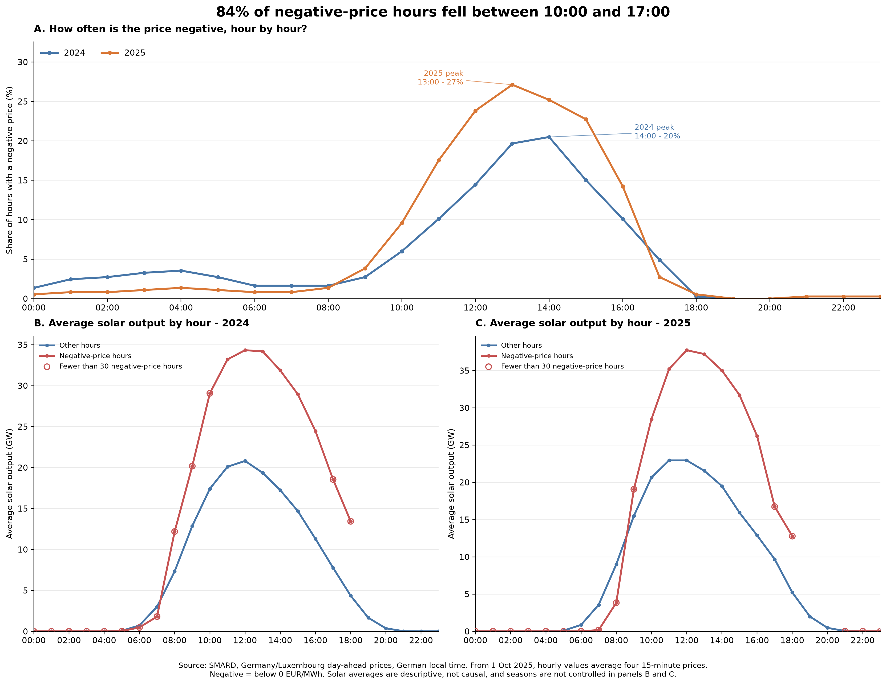

# GridSignal AI

**German Electricity Market Analytics · Python · pandas · Data Validation · Data Visualization**

GridSignal AI is a reproducible Python analytics project investigating negative day-ahead electricity prices in Germany and their relationship with selected wind and solar generation. It transforms hourly SMARD data into validated datasets, descriptive analysis, and visualizations.

The current implementation focuses on data processing, validation, descriptive analytics, and plotting for **2024–2025**. Forecasting, evidence retrieval, and AI-assisted market explanations are planned extensions—not implemented features.

## Project Overview

- **Market:** Germany/Luxembourg day-ahead bidding zone
- **Period:** 2024–2025
- **Source:** [SMARD](https://www.smard.de/en)
- **Current stack:** Python, pandas, matplotlib, pytest
- **Current focus:** Negative-price frequency and severity, wind/solar comparisons, residual-load analysis, and monthly and hourly patterns
- **Status:** Local analytics pipeline, data validation, analysis scripts, tests, findings, and visualizations
- **Future direction:** Forecasting, evidence retrieval, and AI-assisted explanations

## Key Findings

These are descriptive results from the analyzed dataset. They identify associations and patterns but do not establish causation or statistical significance.

### Negative-price frequency

Negative-price observations increased from **457 hours in 2024** to **573 hours in 2025**—an increase of 116 hours, or **25.4%**.

| Month | 2024 negative-price hours | 2024 frequency | 2025 negative-price hours | 2025 frequency |
|---|---:|---:|---:|---:|
| May | 78 | 10.48% | 129 | 17.34% |
| June | 64 | 8.89% | 141 | 19.58% |

The frequency increased by 6.86 percentage points in May and 10.69 percentage points in June.

June 2025 had the highest observed monthly negative-price frequency in the dataset. The frequency then fell to 1.61% in July 2025, showing substantial month-to-month variation.

### Solar generation by price category

Average solar generation was higher during negative-price hours in both years.

- **2024:** Negative-price hours—457; average solar generation—25,540 MWh. Non-negative-price hours—8,327; average solar generation—6,217 MWh.
- **2025:** Negative-price hours—573; average solar generation—31,266 MWh. Non-negative-price hours—8,184; average solar generation—6,880 MWh.

In 2025, average solar generation during negative-price hours was approximately **4.5 times** the average during non-negative-price hours.

These are averages per observed hourly interval, not totals. Demand, conventional generation, storage, cross-border flows, and other market conditions may also affect prices.

### Negative-price severity

- **Below −100 €/MWh:** 2024—5 hours (1.1%); 2025—13 hours (2.3%)
- **−100 to −50 €/MWh:** 2024—22 hours (4.8%); 2025—17 hours (3.0%)
- **−50 to −20 €/MWh:** 2024—61 hours (13.3%); 2025—54 hours (9.4%)
- **−20 to −10 €/MWh:** 2024—49 hours (10.7%); 2025—51 hours (8.9%)
- **−10 to 0 €/MWh:** 2024—320 hours (70.0%); 2025—438 hours (76.4%)

Most negative-price hours remained between −10 and 0 €/MWh. The annual minimum was **−135.45 €/MWh in 2024** and **−250.32 €/MWh in 2025**.

Frequency and severity therefore provide different perspectives: negative prices became more frequent, while the distribution shifted toward the mildest negative-price band. The number of hours below −100 €/MWh also increased, although those observations remain relatively rare.

### Monthly and hourly patterns

Across the 13 year-month combinations with at least 30 negative-price hours, average solar generation was higher during negative-price hours in all 13 cases.

- **Mean difference:** approximately 20,334 MWh per observed hourly interval
- **Median difference:** approximately 19,168 MWh per observed hourly interval
- **Median relative difference:** 245.8%
- **Screening threshold:** 30 negative-price hours per month; this is an inclusion rule, not a significance test

The hour with the highest negative-price frequency was:

- **2024:** 14:00 German local time—75 of 366 observed hours (20.49%)
- **2025:** 13:00 German local time—99 of 365 observed hours (27.12%)

The peak frequency was about 6.63 percentage points higher in 2025.

At 11:00 local time in 2025, average solar generation was approximately **35,216 MWh** during negative-price hours and **22,946 MWh** during non-negative-price hours—a difference of about 12,270 MWh (53%).

For month-hour comparisons, groups required at least five negative-price observations. At 13:00, 11 of 12 qualifying groups had higher average solar generation during negative-price observations (91.7% of qualifying groups, not all negative-price hours). August 2025 was the exception.

These comparisons do not control for demand, wind, conventional generation, storage, or cross-border flows.

### Residual load and market conditions

The combined dataset contains **17,544 hourly observations**:

| Price category | Observed hours | Average price (€/MWh) | Average grid load (MWh) | Average selected renewables (MWh) | Average residual load (MWh) |
|---|---:|---:|---:|---:|---:|
| Negative price | 1,030 | -11.19 | 49,459.16 | 45,724.73 | 3,734.43 |
| Non-negative price | 16,514 | 89.84 | 53,900.70 | 21,962.50 | 31,938.20 |

Negative-price intervals represented **5.87%** of the combined observations.

During negative-price intervals:

- Average selected renewable generation was approximately **23,762.23 MWh higher** than during non-negative-price intervals.
- Average grid load was approximately **4,441.54 MWh lower**.
- Average residual load was approximately **28,203.77 MWh lower**.

Residual load represents grid load after subtracting the selected wind and solar generation components.

The correlation analysis showed:

| Variable pair | Correlation |
|---|---:|
| Price and grid load | 0.308 |
| Price and selected renewables | -0.651 |
| Price and residual load | 0.827 |
| Grid load and selected renewables | 0.280 |
| Grid load and residual load | 0.370 |
| Selected renewables and residual load | -0.788 |

Across residual-load quintiles, average prices increased from **18.25 €/MWh in the very-low-residual-load group** to **140.78 €/MWh in the very-high-residual-load group**.

Negative-price observations were concentrated in the very-low-residual-load quintile: **1,026 of its 3,509 observations** had negative prices. The remaining residual-load quintiles contained very few or no negative-price observations.

These results show descriptive relationships across the observed dataset. They do not isolate residual load from time of day, seasonality, generation availability, cross-border flows, or other market conditions.

See [detailed findings](docs/findings.md) for supporting analysis, tables, and limitations.

## Visualizations

### Monthly negative-price frequency



Share of observed hourly intervals with day-ahead prices below 0 €/MWh by month.

### Negative-price severity



Annual distribution of negative-price hours across five price ranges.

### Hour-of-day analysis



Negative-price frequency by German local hour and average solar generation by price category.

## Data and Scope

**Source:** [SMARD — Germany's electricity market data platform](https://www.smard.de/en)

The project uses hourly data for the Germany/Luxembourg bidding zone:

- Day-ahead electricity prices (€/MWh)
- Actual offshore wind generation
- Actual onshore wind generation
- Actual solar generation

The selected generation measures do not represent total electricity supply or every renewable source.

### Data quality and limitations

- **2024:** 8,784 hourly records (leap year).
- **2025:** 8,760 hourly records.
- **Combined dataset:** 17,544 matched hourly price and generation records.
- Price and generation records are matched using UTC timestamps.
- Calendar, monthly, seasonal, and hour-of-day analysis uses `Europe/Berlin`.
- Daylight-saving transitions mean local days and local hours may have different observation counts.
- Negative-price frequency uses observed hourly records as its denominator.
- Months without negative-price hours cannot support a comparison between negative and non-negative price categories.
- Some hourly and month-hour comparisons have small negative-price samples.
- The five-observation month-hour threshold is a practical filter, not a significance test.
- The share of qualifying groups with higher solar generation is not the share of all negative-price hours.
- The analysis is descriptive: it does not prove causation or statistical significance.
- Generation values follow the downloaded source data; source definitions and units should be checked before commercial interpretation.
- The combined UTC timeline was validated for continuity and duplicate timestamps.
- Selected daylight-saving source records were inspected; this does not independently verify every original source row.
- The dataset covers 2024–2025 and should not automatically be assumed to represent future market conditions.

## Methodology

1. **Inspect** source files, columns, timestamps, and data quality.
2. **Clean** timestamps and numeric values, handle missing data, and normalize timestamps.
3. **Validate** required columns, duplicate timestamps, interval continuity, and price/generation matching.
4. **Combine** price and selected generation data using UTC timestamps.
5. **Analyze** negative-price frequency and severity, price-category comparisons, demand-price relationships, and monthly, seasonal, and hourly patterns.
6. **Visualize** the main patterns.
7. **Document** findings, assumptions, limitations, and outputs.

The workflow runs locally with downloaded SMARD data and Python.

## Technologies

- **Programming:** Python
- **Data manipulation:** pandas
- **Validation:** Missing-value checks, timestamp validation, duplicate detection, interval continuity
- **Integration:** UTC timestamp matching and joins
- **Analysis:** Grouped comparisons, monthly summaries, hourly patterns, severity analysis, residual-load and demand-price analysis
- **Visualization:** matplotlib
- **Testing:** pytest
- **Reproducibility:** Modular scripts, documented execution sequence, generated outputs

## Repository Structure

```text
GridSignal_AI/
├── data/
│   ├── raw/                  # Local source data; not tracked
│   └── processed/             # Generated datasets; not tracked
├── docs/
│   ├── findings.md
│   ├── PROJECT_MEMORY_GridSignal_AI.md
│   ├── SESSION_UPDATE_TEMPLATE_GridSignal_AI.md
│   ├── negative_price_frequency_2024_2025.png
│   ├── negative_price_severity_2024_2025.png
│   ├── hour_of_day_analysis_2024_2025.png
│   ├── negative_price_comparison_2024_2025.csv
│   ├── hourly_negative_price_frequency_2024_2025.csv
│   └──ourly_solar_by_price_category_2024_2025.csv
├── src/
│   └── gridsignal/
│       ├── __init__.py
│       ├── main.py
│       ├── inspect_dst_consumption_alignment.py
│       ├── inspect_raw_dst_rows.py
│       ├── clean_data.py
│       ├── clean_generation.py
│       ├── prepare_consumption_data.py
│       ├── data_validation.py
│       ├── combine_data.py
│       ├── analyze_hour_of_day.py
│       ├── analyze_negative_price_hours.py
│       ├── plot_negative_price_frequency.py
│       ├── plot_negative_price_severity.py
│       └── plot_hour_of_day_analysis.py
├── tests/
│   └── test_data_pipeline.py
├── .gitignore
├── pyproject.toml
└── README.md
```

Raw and processed datasets, temporary diagnostics, and generated intermediate files are local and excluded from version control. Analysis scripts, findings, permanent analytical outputs, and project documentation are intended for the repository.

## Run Locally

Instructions below describe the Windows PowerShell workflow.

### Requirements

- Python 3.14 or later, as specified in the current project configuration
- pip
- Git

### 1. Clone

```powershell
git clone https://github.com/aliakbarse/GridSignal-AI.git
cd GridSignal-AI
```

### 2. Create and activate a virtual environment

```powershell
python -m venv .venv
.\.venv\Scripts\Activate.ps1
```

If PowerShell prevents activation, consult the Python documentation for your environment's execution-policy settings.

### 3. Install the project and development dependencies

```powershell
python -m pip install -e ".[dev]"
```

### 4. Download source data

Download the hourly day-ahead price and actual-generation CSV files from [SMARD](https://www.smard.de/en). Place the files in `data/raw/` with the expected names:

```text
data/raw/
├── Day-ahead_prices_202312312100_202512312100_Hour.csv
└── Actual_generation_202312312100_202512312100_Hour.csv
```

These are local inputs and are not tracked in Git. Check the applicable source terms before redistributing downloaded data.

### 5. Run the core analytics pipeline

Run from the repository root:

```powershell
python -m gridsignal.clean_data
python -m gridsignal.clean_generation
python -m gridsignal.combine_data
python -m gridsignal.plot_negative_price_frequency
python -m gridsignal.analyze_hour_of_day
python -m gridsignal.plot_negative_price_severity
python -m gridsignal.plot_hour_of_day_analysis
```

The scripts generate processed datasets under `data/processed/` and analytical outputs and charts under `docs/`.

### 6. Run additional analytics

The following analyses require the combined market dataset. Demand-price analysis also requires the raw electricity consumption dataset.

#### Negative-price and hourly analysis

After the combined market dataset is available, run:

```powershell
python -m gridsignal.analyze_negative_price_hours
```

#### Demand-price analysis

Place the raw consumption dataset at:

```text
data/raw/Actual_consumption_202312312100_202512312100_Hour.csv
```

After the combined market dataset and required consumption dataset are available, prepare the merged dataset:

```powershell
python -m gridsignal.prepare_consumption_data
```

The preparation script validates the market and consumption timestamps before merging the datasets.

These analyses are separate from the project's initialization entry point.


### 7. Run optional timestamp and DST diagnostics

The following scripts are available for inspecting timestamp alignment and daylight-saving-time records:

```powershell
python -m gridsignal.inspect_dst_consumption_alignment
python -m gridsignal.inspect_raw_dst_rows
```

These are diagnostic tools rather than required stages of every analytics run. Review their output when investigating timestamp or DST-related questions.

### 8. Run tests

```powershell
python -m pytest -v
```

The test suite covers key data-pipeline rules, including negative-price classification, timestamp validation, and matching price and generation records. Passing tests verify the tested rules; they do not independently validate every analytical conclusion.

## Planned Development

The following capabilities are planned and are not part of the current implementation:

1. **Expanded market analytics:** Investigate additional price patterns and renewable-generation relationships.
2. **Forecasting:** Develop baseline models and evaluate them against benchmarks.
3. **Evidence retrieval:** Retrieve relevant evidence from official energy-market and regulatory documents.
4. **AI orchestration:** Use LangGraph for multi-step, traceable answers.
5. **Evaluation:** Measure forecast accuracy, retrieval relevance, citation quality, and system performance.
6. **Application and observability:** Expose the system through an API and add monitoring and further testing.

Potential future technologies include DuckDB, Parquet, scikit-learn, LightGBM, PostgreSQL with pgvector, FastAPI, LangGraph, and Langfuse.

These are planned components, not implemented features.

## Project Principles

- Support analytical claims with measurable evidence.
- Preserve data provenance and document limitations.
- Compare forecasting models with appropriate baselines.
- Distinguish verified facts, model outputs, and uncertainty.
- Do not present correlation as causation.
- Make analysis reproducible and results interpretable.

## License

A license has not yet been selected. Project code and third-party data remain subject to their applicable terms until licensing and redistribution permissions are confirmed.