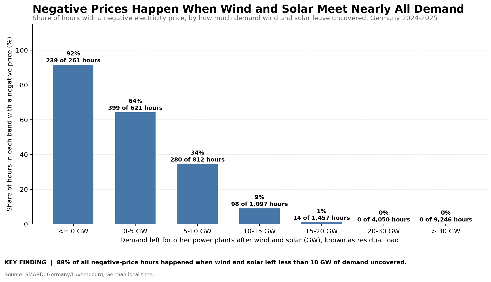
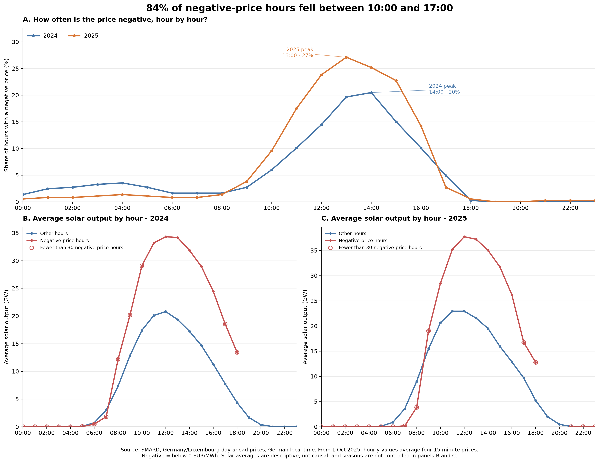
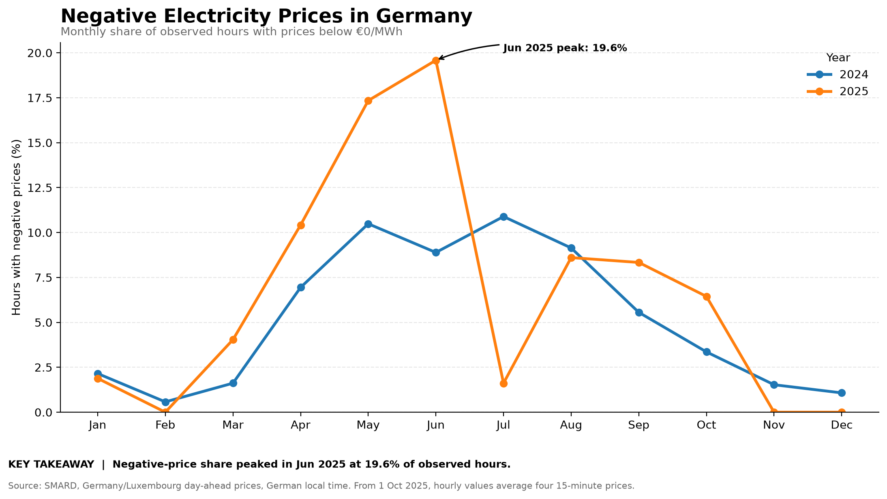
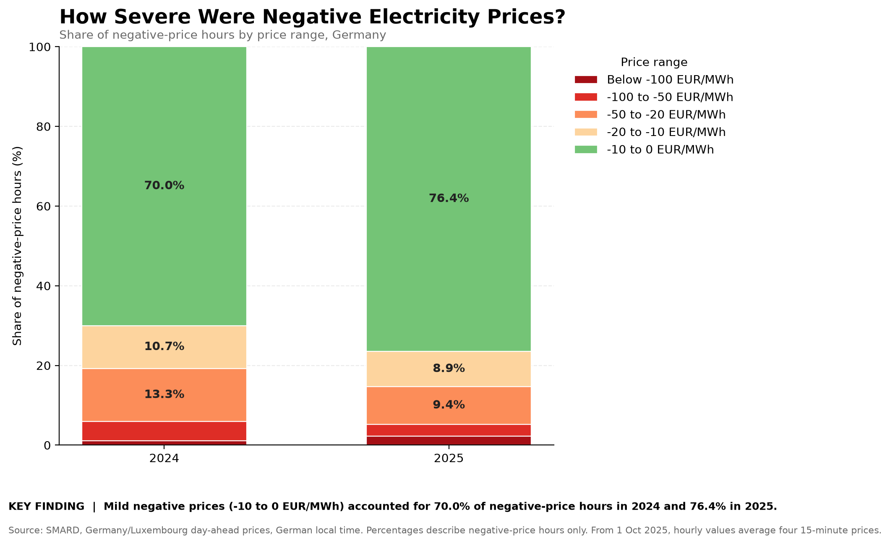

# GridSignal AI — Key Findings

## 1. Research Question

When do negative electricity prices occur in the German day-ahead market in 2024–2025, and what separates negative-price hours from all other hours?

All results are descriptive associations in two years of hourly data. They do not establish causation.

## 2. Finding One: Residual Load Separates Negative-Price Hours Best

Residual load is grid load minus wind and solar generation: the amount other power plants still have to supply. The table groups all 17,544 hours into fixed residual-load bands.

| Residual load | Hours | Negative-price hours | Share negative | Average price (€/MWh) | Median price (€/MWh) |
|---|---:|---:|---:|---:|---:|
| ≤ 0 GW | 261 | 239 | 91.6% | −24.0 | −10.2 |
| 0–5 GW | 621 | 399 | 64.3% | −4.6 | −0.1 |
| 5–10 GW | 812 | 280 | 34.5% | 8.3 | 1.0 |
| 10–15 GW | 1,097 | 98 | 8.9% | 29.8 | 26.4 |
| 15–20 GW | 1,457 | 14 | 1.0% | 51.9 | 55.1 |
| 20–30 GW | 4,050 | 0 | 0.0% | 75.7 | 78.0 |
| > 30 GW | 9,246 | 0 | 0.0% | 114.6 | 106.0 |

The share column answers "in this band, how often is the price negative?" A different question gives a different number: 918 of the 1,030 negative-price hours (89%) fell in the three lowest bands, below 10 GW.

### Negative-price hours compared with all other hours

| Hours | Count | Average price (€/MWh) | Average grid load (GW) | Average wind and solar (GW) | Average residual load (GW) |
|---|---:|---:|---:|---:|---:|
| Negative price | 1,030 | −11.19 | 49.5 | 45.7 | 3.7 |
| Non-negative price | 16,514 | 89.84 | 53.9 | 22.0 | 31.9 |

Negative-price hours made up 5.87% of all hours. Their residual load was 28.2 GW lower. About 84% of that gap comes from higher wind and solar output (23.8 GW) and about 16% from lower demand (4.4 GW).

### Correlation with price

| Variable | Pearson | Spearman |
|---|---:|---:|
| Grid load | 0.308 | 0.279 |
| Wind and solar | −0.651 | −0.695 |
| Residual load | 0.827 | 0.869 |

Pearson measures how close the relationship is to a straight line, Spearman how consistently the two variables rise and fall together.

**Interpretation:** Negative prices almost never occur once other plants must supply 20 GW or more, and become the norm when wind and solar cover all of demand. The relationship is partly mechanical, because residual load is built from demand and generation, so it is a strong descriptor of market conditions rather than proof of a cause.

**Caveats:** The middle bands are mixed (34.5% negative at 5–10 GW), so other factors matter there. Residual load subtracts only wind and solar, and it is an hourly national average that can hide short or regional surpluses.

**Supporting files:** `price_by_residual_load_band_2024_2025.csv`, `price_correlations_2024_2025.csv`, `negative_price_comparison_2024_2025.csv`

## 3. Finding Two: Solar Alone Is a Weak Explanation

Average solar output is much higher in negative-price hours, but the raw comparison is misleading. Negative prices occur mostly at midday in the sunny months, so the negative-price group contains mainly midday summer hours, while the other group contains every night hour. The comparison below holds time of day and season constant step by step. Solar output is the average per hour, in GW.

| Year | Comparison | Negative-price hours | Other hours | Ratio |
|---|---|---|---|---|
| 2024 | All hours | 457 hours, 25.5 GW | 8,327 hours, 6.2 GW | 4.11× |
| 2024 | Midday (11:00–14:59) | 237 hours, 33.3 GW | 1,227 hours, 19.4 GW | 1.72× |
| 2024 | Midday, April–September | 218 hours, 34.4 GW | 514 hours, 29.5 GW | 1.16× |
| 2024 | …on weekdays | 87 hours, 34.9 GW | 437 hours, 29.5 GW | 1.19× |
| 2024 | …on weekends | 131 hours, 34.0 GW | 77 hours, 29.8 GW | 1.14× |
| 2025 | All hours | 573 hours, 31.3 GW | 8,187 hours, 6.9 GW | 4.55× |
| 2025 | Midday (11:00–14:59) | 342 hours, 36.4 GW | 1,118 hours, 21.8 GW | 1.67× |
| 2025 | Midday, April–September | 302 hours, 37.8 GW | 430 hours, 32.1 GW | 1.18× |
| 2025 | …on weekdays | 152 hours, 39.6 GW | 372 hours, 32.3 GW | 1.23× |
| 2025 | …on weekends | 150 hours, 35.9 GW | 58 hours, 30.8 GW | 1.17× |

**Interpretation:** Most of the raw gap reflects when negative prices happen, not solar output alone. Within midday hours of April–September, negative-price hours still have about 16–18% more solar output, so a small association remains. Weekends do not explain it: the weekday and weekend ratios are similar, although the weekend samples are small.

**Caveats:** Demand, wind, power-plant flexibility and cross-border flows are not controlled.

**Supporting file:** `solar_comparison_controls_2024_2025.csv`

## 4. Finding Three: Negative Prices Cluster Around Midday

84% of negative-price hours (863 of 1,030) fell between 10:00 and 17:00 German local time.

| Year | Peak hour (local time) | Negative-price hours | Observed hours | Negative-price rate |
|---|---:|---:|---:|---:|
| 2024 | 14:00 | 75 | 366 | 20.49% |
| 2025 | 13:00 | 99 | 365 | 27.12% |

The peak rate was about 6.63 percentage points higher in 2025. Overnight rates stayed in the low single digits in 2024 and below 2% in 2025.

Comparing hours at the same time of day removes the daily solar cycle. At 11:00 in 2025, average solar output was about 35.2 GW in negative-price hours and 22.9 GW in other hours, a difference of about 12.3 GW (53%). Seasons are not controlled in this comparison. Averages for hours with fewer than 30 negative-price observations, mostly overnight and at the edges of the day, are flagged on the chart and should be read cautiously.

**Supporting files:** `hourly_negative_price_frequency_2024_2025.csv`, `hourly_solar_by_price_category_2024_2025.csv`

## 5. Finding Four: Negative Prices Became More Frequent in 2025, Mostly in Spring

Negative-price hours rose from 457 in 2024 to 573 in 2025 (+116, or +25.4%).

| Month | 2024 hours | 2024 frequency | 2025 hours | 2025 frequency |
|---|---:|---:|---:|---:|
| January | 16 | 2.15% | 14 | 1.88% |
| February | 4 | 0.57% | 0 | 0.00% |
| March | 12 | 1.62% | 30 | 4.04% |
| April | 50 | 6.94% | 75 | 10.42% |
| May | 78 | 10.48% | 129 | 17.34% |
| June | 64 | 8.89% | 141 | 19.58% |
| July | 81 | 10.89% | 12 | 1.61% |
| August | 68 | 9.14% | 64 | 8.60% |
| September | 40 | 5.56% | 60 | 8.33% |
| October | 25 | 3.36% | 48 | 6.44% |
| November | 11 | 1.53% | 0 | 0.00% |
| December | 8 | 1.08% | 0 | 0.00% |

April to June added 153 hours (192 in 2024, 345 in 2025). July 2025 fell by 69 hours compared with July 2024, which offsets part of that gain; the other months net to +32. June 2025 had the highest monthly frequency in the dataset (19.58%), and the July 2025 drop is not yet explained.

## 6. Finding Five: Most Negative Prices Are Mild

| Negative-price range | 2024 hours | 2024 share | 2025 hours | 2025 share |
|---|---:|---:|---:|---:|
| Below −100 €/MWh | 5 | 1.1% | 13 | 2.3% |
| −100 to −50 €/MWh | 22 | 4.8% | 17 | 3.0% |
| −50 to −20 €/MWh | 61 | 13.3% | 54 | 9.4% |
| −20 to −10 €/MWh | 49 | 10.7% | 51 | 8.9% |
| −10 to 0 €/MWh | 320 | 70.0% | 438 | 76.4% |
| **Total** | **457** | **100.0%** | **573** | **100.0%** |

Percentages describe negative-price hours only, not all hours. Mild prices between −10 and 0 €/MWh made up 70.0% of negative-price hours in 2024 and 76.4% in 2025. Hours below −100 €/MWh rose from 5 to 13, but the counts are small. The lowest price was −250.32 €/MWh in 2025 (−135.45 in 2024), yet that single extreme does not mean prices were generally more severe: the mean negative price was −11.50 €/MWh in 2024 and −10.95 €/MWh in 2025, and the median was about −2.0 €/MWh in both years.

## 7. Data Coverage and Limitations

- The combined dataset has 17,544 matched hourly records: 8,784 in 2024 (a leap year) and 8,760 in 2025.
- Prices, generation and consumption are matched on UTC timestamps. The UTC timeline has no duplicates and no gaps. Calendar analysis uses `Europe/Berlin` local time.
- At the spring daylight-saving change the local 02:00 hour is absent; in autumn the local 02:00 label repeats. The raw source timestamps do not distinguish the two repeated hours. The inspected raw consumption records matched the merged records in source order and in value, but this does not independently verify every source row.
- Negative means strictly below €0/MWh. Counting zero-price hours as well would give 519 hours in 2024 and 655 in 2025.
- From 1 October 2025 the day-ahead market uses 15-minute products, and hourly values after that date average four quarter-hours.
- Residual load subtracts only wind and solar. Hydro, biomass, imports and exports are not included, and the generation measures are not total supply.
- The controlled solar comparisons hold time of day and season constant. They do not control for demand, wind, conventional generation, storage, cross-border flows or subsidy rules.
- Some groups are small, such as the weekend comparisons (58 and 77 other hours) and overnight hours with few negative prices.
- February, November and December 2025 had no negative-price hours, so no negative-versus-other comparison exists for those months.
- Before commercial use, check the original SMARD field definitions and units.
- Two years of data should not be assumed to represent future market conditions.

## 8. Conclusion

Negative prices in 2024–2025 occurred almost entirely when wind and solar covered most of demand: 89% of negative-price hours had a residual load below 10 GW, and none occurred above 20 GW. Solar output alone explains much less than the raw comparison suggests, because most of its apparent effect comes from timing at midday in spring and summer. Negative prices cluster between 10:00 and 17:00, rose in spring 2025 and remained mostly mild, although the sharp drop in July 2025 is still unexplained.

These findings describe associations in two years of hourly data. Next steps are to examine weekends, holidays and night-time wind, to look into the July 2025 drop, and to translate the findings into questions for market participants.